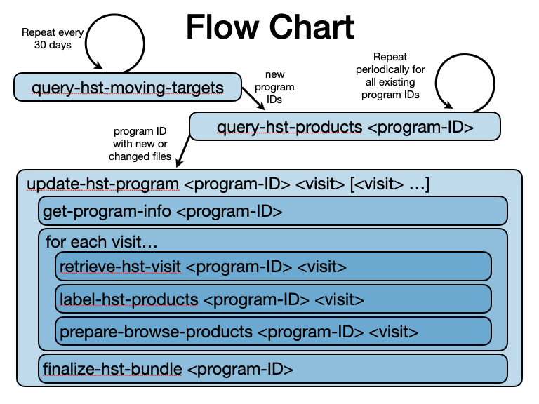

#
# The HST Migration Pipeline Architecture

Version 2.1

July 9, 2024

#
# Terms

- Program ID = the four or five-digit numeric HST proposal ID.
- IPPPSSOOT = the format of the first nine characters in the root name of a file. I indicates instrument, PPP indicates program, SS for visit, OO for observation, T for transmission/association.
- IPPPSSOO = the first eight characters. On occasion, files have the same “IPPPSSOO” but the “T” character is different. Nevertheless, files with the same IPPPSSOO are always associated, regardless of the “T”.
- VISIT = the two character designation for the HST visit, the “SS” in IPPPSSOOT.
- TRL: File suffix that describes the processing history of all the files with the same IPPPSSOOT prefix.
- SPT/SHM/SHF: File suffix that identifies the target for each IPPPSSOOT prefix. These are often collectively referred to as “SPT” files, even if the suffixes differ.

#
# "Logically Complete"

- The “logically complete” set of data files is one in which every file to which another file might refer is also in the set.
  - The pipeline will produce incorrect results if an attempt is made to run it on sets of files that are not logically complete.
- Often, all the files with a single IPPPSSOO are logically complete.
- For files with associations (e.g., repeat and CR-split exposures), the logically complete set is defined by the union of:
  - the IPPPSSOO of the association file “\*\_asn.fits”
  - every other file with that IPPPSSOO.
  - every file with an IPPPSSOO referenced within the association file.
- You can recognize these cases because the “T” in IPPPSSOOT is a digit, usually 0. Under other circumstances, the “T” is never a digit.
- Because associated files never cross a visit boundary, it probably makes most sense to focus on archiving files by visit.
- A visit is limited to ~ 6 orbits of HST, so this approach has the advantage of also limiting the volumes of data that the pipeline has to deal with at any given time.

#
# File System Organization

- I suggest we organize all information about the processing pipeline by program ID and visit within a single directory tree.
- The directory path is always `<root>/hst_\nnnnn>/visit_<ss>/`, where nnnnn is the program ID (with leading zero if needed) and ss is the visit.
- The root directory is always defined by the content of an environment variable “`HST_PIPELINE`”.
- All processing logs are separated by visit and saved in within a subdirectory “`logs/`” inside each visit-level directory.
- Any other information that needs to be managed by the pipeline can be saved in files within this tree.
- We should not use this directory tree to store data files and their labels while in development.
- I suggest we use the same hierarchy, but have them in a root directory defined by environment variable “`HST_STAGING`”.
- The pipeline also needs to reference the location of all current HST bundles as defined by environment variable “`HST_BUNDLES`”.
- See the document PDS4-VERSIONING.txt on Dropbox for the details about the layout of the `HST_BUNDLES` tree.
- Note: It probably makes sense to move the target identification WEBCACHE out of GitHub and into this directory tree as `<HST_PIPELINE>/target-identifications/WEBCACHE`.
- Summary:
  - `HST_BUNDLES`: store final deliverable bundles.
  - `HST_STAGING`: store data files downloaded from MAST.
  - `HST_PIPELINE`: store data info for each proposal id, including pipeline logs, program info file, list of product names and trl checksum file.

#
# What is a Task?

- A task is a single stand-along program that executes some piece of the pipeline and then stops. It can be typed as a command at the terminal if desired.
- Every time a task runs, it creates a unique log file describing what it has done.
- Tasks are designed to be relatively independent of one another, so that multiple tasks can run in parallel, using multiple threads, without interfering with one another.
- Log files are given the name of the task, followed by “`-yyyy-mm-ddThh-mm-ss.log`” containing the local time at which the task started in the format year-month-day-hour-minute-second. They are saved in “`logs/`” subdirectories at various levels in the file system hierarchy.
- Every warning and error a task logs is also appended to its program's `<HST_PIPELINE>/hst_<nnnnn>/WARNINGS.log`; a task for no one program uses `<HST_PIPELINE>/logs/WARNINGS.log`.
- Each task run that logged a warning or worse, and each task the queue saw fail or killed, adds a line to `<HST_PIPELINE>/NEEDS_REVIEW.log`: the time, the command, the message counts or problem, and the task's log. Delete either file to acknowledge it.
- The pipeline is “queue-based”, meaning that it maintains a queue of available tasks.
- Just before completion, tasks typically generate one or more new tasks and add them to the task queue.

#
# The Task Queue

- The design and implementation of the Task Queue and the Queue Manager is in `src/hst_pipeline/queue_manager` module. Task at the later pipeline stage and with higher priority will be executed first, this will make sure the pipeline prioritize finishing a bundle over starting a new process.
- Requirements include:
  - A task can add one or more new tasks to the queue, with a specified delay or level of priority, and then proceed asynchronously.
  - A task can add one or more new tasks to the queue, with a specified level of priority, and then wait for them to finish.
  - A task can ask the queue manager if a task that it sent to the queue manager is now complete.
- Priorities are 1 (Lowest) to 5 (Highest).
  - Priorities are assigned so that once we begin processing an HST bundle, we prioritize finishing it over starting a different bundle.
- Rob has agreed to research Queue Manager options for us. After Rob's research, we've agreed on implementing our own Queue Manager.

#
# Overview of Tasks

- **query-hst-moving-targets** \<query constraints\>
  - runs periodically (or can be run manually) to get a list of programs with moving targets.
- **query-hst-products** \<program-ID\>
  - get a complete list of the accepted files for a specified program. Only observations of moving targets are included, except that every FGS and HSP observation is included, because MAST does not flag their targets as moving.
- **update-hst-program** \<program-ID\> \<visit\> [\<visit\> …]
  - overall task to create a new bundle or to manage the update of an existing bundle.
- **get-program-info** \<program-ID\>
  - retrieve the online files that describe a program (such as .apt or .pro) and assemble other program-level information. Early programs (roughly Cycles 1–3) have no .apt or .pro file; for them the citation information (title, PI, cycle, abstract) is read from the MAST proposal search page, saved as `<nnnnn>.html` and delivered in the bundle's document collection in place of the proposal files, stripped of the MAST site's header and footer; the document label gives its URL and retrieval date in an `External_Reference`.
- **retrieve-hst-visit** \<program-ID\> \<visit\>
  - retrieve the accepted FITS files and browse products from MAST.
- **prepare-browse-products** \<program-ID\> \<visit\>
  - move the retrieved files into their collection directories, so each is stored once.
- **label-hst-products** \<program-ID\> \<visit\>
  - create labels for the FITS data files and the browse products.
- **finalize-hst-bundle** \<program-ID\>
  - package a complete set of files in the staging directories as a new bundle or as updates to an existing bundle

#
# Work Flow

#
# Task: **query-hst-moving-targets**

- Initiated by: **query-hst-moving-targets**, or manually.
- Input:
  - Optional range of instruments, dates, or program IDs.
  - Note: Command line syntax can be largely based on what is in Dave’s current version of query-mast.py.
- Log: `<HST_PIPELINE>/logs/query-hst-moving-targets-<ymdhms>`.logs.
- Priority: 1 (Lowest)
- State:
  - There is always one `<HST*PIPELINE>/hst*<nnnnn>` directory for each HST program that is known to contain planetary observations.
- Actions:
  - Query MAST for any program IDs that meet the query constraints.
  - For each subdirectory of `<HST_PIPELINE>` that is missing, queue task **query-hst-products** for that program ID.
  - Also re-queue task **query-hst-moving-targets** with a 30-day delay.  ([To be implemented](https://github.com/SETI/rms-hst-pipeline/issues/104))

#
# Task: **query-hst-products** (1)

- Initiated by: **query-hst-moving-targets**, **query-hst-products**, or manually.
- Input: program ID
- Log: `<HST_PIPELINE>/hst_<nnnnn>/logs/query-hst-products-<ymdhms>.log`
- Priority: 1 (Lowest)
- State:
  - File `<HST_PIPELINE>/hst_<nnnnn>/visit_<ss>/products.txt` contains the list of products with accepted suffixes, sorted alphabetically, as of the visit's last labeling. Missing until the visit has been labeled.
  - File `<HST_PIPELINE>/hst_<nnnnn>/visit_<ss>/trl_checksums.txt` contains the TRL files and their checksums as of the visit's last labeling. Missing until the visit has been labeled.
- Actions:

  - Query MAST for all available visits and files in this program.
  - Create `<HST_PIPELINE>/hst_<nnnnn>/` and any `visit_<ss>/` subdirectories that do not already exist.
  - Download all the TRL files for this HST program to `<HST_STAGING>/hst_<nnnnn>/`.

#
# Task: **query-hst-products** (2)

- Actions (continued):
  - For each visit…
    - Compare the list from MAST with `<HST_PIPELINE>/hst_<nnnnn>/visit_<ss>/products.txt`, and the checksums of the staged TRL files with `trl_checksums.txt`. The visit has changed if either file is missing or differs.
    - For a changed visit, write the new list as `products.txt.pending` and/or `trl_checksums.txt.pending`. **label-hst-products** moves them into place once it has labeled the visit, and a failed **retrieve-hst-visit** deletes them. A visit whose retrieval or labeling never finished therefore keeps its old lists and is found changed again by the next query.
    - For an unchanged visit, delete any pending list left by an earlier run.
    - Delete the TRL files.
  - Create a list of visits in which any files are new or changed.
  - If the list is not empty, queue task **update-hst-program** with the list of visits.
  - If the list was empty, re-queue task **query-hst-products** with a 30-day delay. ([To be implemented](https://github.com/SETI/rms-hst-pipeline/issues/104))
  - Otherwise, re-queue task **query-hst-products** with a 90-day delay. ([To be implemented](https://github.com/SETI/rms-hst-pipeline/issues/104))

#
# Task: **update-hst-program**

- Initiated by: **query-hst-products**
- Input: program ID, list of visits.
- Log: `<HST_PIPELINE>/hst_<nnnnn>/logs/update-hst-program-<ymdhms>.log`
- Priority: 2 (Low)
- State:
  - Each changed visit has `products.txt.pending` and/or `trl_checksums.txt.pending` in `<HST_PIPELINE>/hst_<nnnnn>/visit_<ss>/`.
- Actions:
  - Queue task **get-program-info** and wait for it to complete.
  - For each visit, queue task **update-hst-visit** and wait until all the visits have completed.
  - Queue task: **finalize-hst-bundle** and wait for it to finish.
  - Send some sort of notification.

#
# Task: **get-program-info**

- Initiated by: **update-hst-program**
- Input: program ID
- Log: `<HST_PIPELINE>/hst_<nnnnn>/logs/get-program-info-<ymdhms>.log`
- Priority: 5 (Highest)
- State:
  - Directory `<HST_PIPELINE>/hst_<nnnnn>/` contains the proposal files `<nnnnn>.apt`, `.pro`, and/or `.prop` files, plus the `.pdf` version. Absent on first run.
  - File `<HST_PIPELINE>/hst_<nnnnn>/program-info.txt` contains citation info and maybe other info about the program overall. Absent on first run. It stays in the pipeline directory and is not delivered in the bundle.
- Actions:
  - Retrieve the proposal files via a web query.
  - If these files are the same as the existing ones, stop.
  - Otherwise,
    - Rename each existing file by appending “`-<ymdhms>`” before its extension and moving it to a `backups/` subdirectory. All the files replaced by one download share one time; **finalize-hst-bundle** sets the document's minor version to the number of these times.
    - Then save the newly downloaded files.
    - Regenerate `program-info.txt` with a possibly modified citation.

#
# Task: **update-hst-visit**

- Initiated by: **update-hst-program**
- Input: program ID, visit.
- Log: `<HST_PIPELINE>/hst_<nnnnn>/logs/update-hst-visit<ymdhms>.log`
- Priority: 3 (Medium)
- Actions:
  - Queue **retrieve-hst-visit** for this visit and wait for it to complete.
  - Queue task **prepare-browse-products** for this visit and wait for it to complete.
  - Queue **label-hst-products** for this visit and wait for it to complete.

#
# Task: **retrieve-hst-visit**

- Initiated by: **update-hst-visit**
- Input: program ID and visit
- Log: `<HST*PIPELINE>/hst*<nnnnn>/visit\_<ss>/logs/retrieve-hst-visit-<ymdhms>.log`
- Priority: 4 (High)
- State:
  - The file `<HST*PIPELINE>/hst*<nnnnn>/visit\_<ss>/products.txt.pending` contains the list of available products (FITS files or browse products) with approved suffixes.
- Actions:
  - Retrieve all the identified files and put them in `<HST*STAGING>/hst*<nnnnn>/visit\_<ss>/`.
  - If the download fails, delete the visit's pending lists, so that the next **query-hst-products** finds the visit changed again.

#
# Task: **prepare-browse-products**

- Initiated by: **update-hst-visit**
- Input: program ID and visit
- Log: `<HST_PIPELINE>/hst_<nnnnn>/visit_<ss>/logs/prepare-browse-products-<ymdhms>.log`
- Priority: 5 (Highest)
- State:
  - Downloaded files are in `<HST_STAGING>/hst_<nnnnn>/visit_<ss>/mastDownload/`.
- Actions:
  - Move each downloaded file into its collection directory, `<HST_STAGING>/hst_<nnnnn>/<collection>/visit_<ss>/`, so that each file is stored only once in staging. MAST previews (`.jpg`, `.png`) of non-image products (spectra, and all products of FGS, FOS, GHRS, and HSP) go into `browse_*` collections under their MAST file names. MAST previews of images are not downloaded.
  - Generate a picmaker preview (`mosaic=True`, `footprint=7`, `percentiles=(0.01, 99.99)`, `mask_ranges=(0, 0)`) of each image product that lacks one: the raw, calibrated, and combined images of ACS, FOC, NICMOS, WFC3, WFPC, and WFPC2, and of COS and STIS in imaging mode only (`OBSTYPE = IMAGING`, e.g., target acquisitions), e.g., `browse_wfpc2_c0m/visit_<ss>/<ipppssoot>_c0m.jpg`. Files without an image array, such as a COS ACQ/SEARCH `rawacq` table, are skipped.
  - Mask pixels flagged in the data quality array, which are left out of the stretch but drawn normally: the `DQ` extension of the same file for ACS, COS, NICMOS, STIS, and WFC3, and the separate DQ file (`q0f` for FOC `d0f`; `c1f`/`q0f` for WFPC; `c1m`/`q0m` for WFPC2) from its data quality collection. The `footprint` median filter leaves masked pixels out of each median. NICMOS pixels whose only flags are 16 (grot), 64 (saturated), 1024 (astrophysical source), or 2048 (signal in the 0th read) are not masked, since their values are sound. FOC's calibrated `c0f` images are dezoomed and geometrically corrected, so they have no data quality file and are not masked.
  - Leave in place, with a warning, any file that belongs in no collection.
  - Remove the directories left empty under `mastDownload/`.

#
# Task: **label-hst-products**

- Initiated by: **update-hst-visit**
- Input: program ID and visit
- Log: `<HST_PIPELINE>/hst_<nnnnn>/visit_<ss>/logs/label-hst-products-<ymdhms>.log`
- Priority: 5 (Highest)
- State:
  - New files have been filed by **prepare-browse-products** into `<HST_STAGING>/hst_<nnnnn>/<collection>/visit_<ss>/`.
  - Existing bundle, if any, is at `<HST_BUNDLES>/hst_<nnnnn>-deliverable/hst_<nnnnn>/`.
- Actions:
  - Compare the staged FITS files to those in an existing bundle, if any.
  - Create a new XML label (`<name>.lblx`) for each file, labeling all of the visit's collections together so that labels can refer to the visit's other files.
  - Create a `Product_Browse` label for each preview, from MAST or picmaker, in the visit's `browse_*` collections.
  - Reset the modification dates of the FITS files to match their production date at MAST.
  - If any file contains NaNs, rename the original file with “`-original`” appended, and then rewrite the file without NaNs.
  - Replace the visit's `products.txt` and `trl_checksums.txt` with the pending lists from **query-hst-products**, if any, moving the old ones to `<HST_PIPELINE>/hst_<nnnnn>/visit_<ss>/backups/`.
  - TBD: What to do if the file in the existing bundle is identical.

#

# Task: **finalize-hst-bundle**

- Initiated by: **update-hst-program**
- Input: program ID
- Log: `<HST_PIPELINE>/hst_<nnnnn>/visit_<ss>/logs/finalize-hst-bundle-<ymdhms>.log`
- Priority: 5 (Highest)
- State:
  - Files and labels are in `<HST_STAGING>/hst_<nnnnn>/visit_<ss>/`.
  - All the files and labels inside `<HST_STAGING>/hst_<nnnnn>` and its visit subdirectories are up to date.
- Actions:
  - Get the general label data used in document/schema/context/bundle labels
  - Move existing, superseded files as described in PDS4-VERSIONING.txt ([To be implemented](https://github.com/SETI/rms-hst-pipeline/issues/105))
  - Generate the final document directory under `<HST_BUNDLES>/hst_<nnnnn>-deliverable/hst_<nnnnn>/`. Besides the proposal files, it holds copies of the data and instrument handbooks of the program's instruments, with their labels, taken from the document collection of the HST handbooks bundle named by `$HST_HANDBOOKS`. A handbook belongs to every instrument whose id is a `<keyword>` in its label's `Citation_Information` (e.g., Volume I of the HST Data Handbook has the keyword `FOC`; Volume II has `FOS`, `GHRS`, `HSP`, and `WFPC`); the label is copied with the documents it names. Handbook LIDs use the lower-case instrument id, e.g., `urn:nasa:pds:hst_handbooks:document:wfpc-data-handbook` for WF/PC. The collection inventory lists the handbooks as secondary members, by LID.
  - Generate the final schema directory under `<HST_BUNDLES>/hst_<nnnnn>-deliverable/hst_<nnnnn>/`
  - Generate the final context directory under `<HST_BUNDLES>/hst_<nnnnn>-deliverable/hst_<nnnnn>/`
  - Organize data files from MAST, move them from staging `<HST_STAGING>/hst_<nnnnn>/` to bundles `<HST_BUNDLES>/hst_<nnnnn>-deliverable/hst_<nnnnn>/` (keep files from MAST at staging directory, we could consider removing them since they are not used)
  - Create data collection files for each collection directory under `<HST_BUNDLES>/hst_<nnnnn>-deliverable/hst_<nnnnn>/`
  - Create bundle label under `<HST_BUNDLES>/hst_<nnnnn>-deliverable/hst_<nnnnn>/`
  - Create target label under `<HST_BUNDLES>/hst_<nnnnn>-deliverable/hst_<nnnnn>/context` if it doesn't exist in PDS page
  - Create manifest files in `<HST_BUNDLES>/hst_<nnnnn>-deliverable/` & run validator, which writes `validation-report.txt` there
  - Question: Will we need this process to generate a doi? How do we handle that? ([To be implemented](https://github.com/SETI/rms-hst-pipeline/issues/106))
